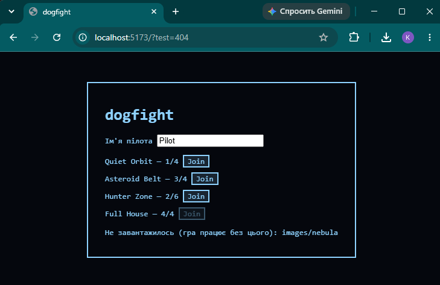
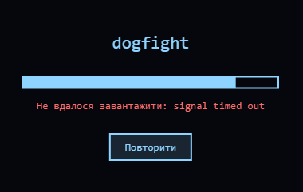
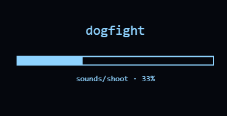
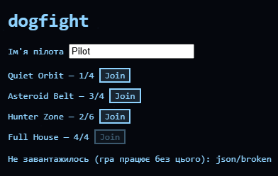
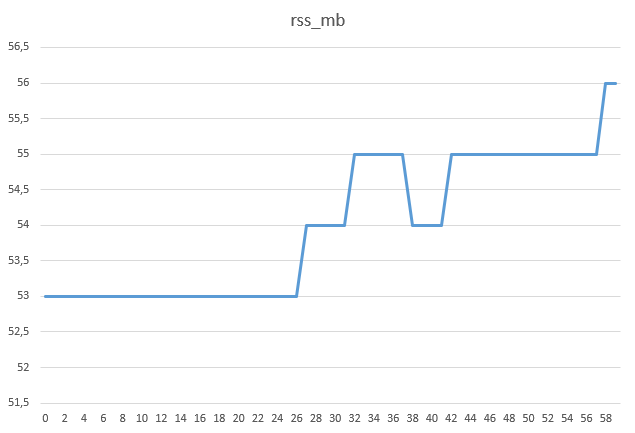
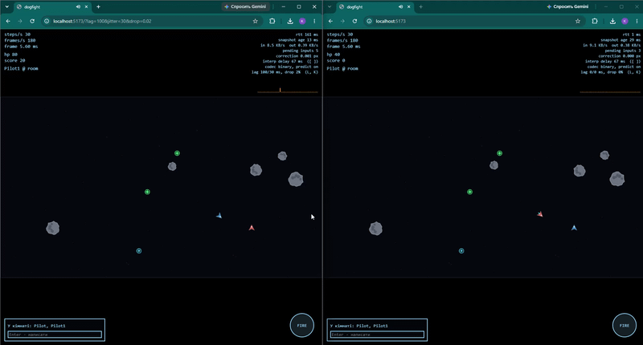
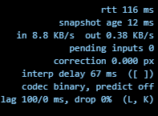

# dogfight

Корабель на canvas, керований фіксованим таймстепом, рендер інтерпольований під частоту монітора.

## Запуск

```
npm install
npm run dev
```

Відкрити посилання з консолі (http://localhost:5173).

Керування: стрілки або WASD, вгору/W — тяга, пробіл або кнопка FIRE — постріл.

## Lab 1 — M1–M3

- [x] цикл на requestAnimationFrame з фіксованим кроком 1/60 і clamp'ом дельти
- [x] HUD зліва: steps/s, frames/s, час кадру
- [x] клавіатура - замикання, justPressed з'їдає сам себе
- [x] корабель - чиста функція integrate, без рендеру всередині
- [x] wrap по краях арени
- [x] рендер інтерпольований (lerp / lerpAngle), корабель не смикається
- [x] canvas під DPR, ресайз по вікну

## Lab 1 — M4, три поломки

### 1. Busy-wait у render

Додав `while (performance.now() < t + 100) {}` всередину render раз на 60 кадрів.

Що видно на екрані: Гра стає плавною (у звичайний момент `frames/s` тримається на рівні ~147, а час кадра біля `5.70 ms`), але рівно раз на секунду відбувається помітний мікрофриз (ривок) картини. У цей момент час кадру різко стрибає вище 100 мс, а `frames/s` суттєво просідає.

Чому це не обійти з JS того самого потоку: цикл рендеру і симуляції виконуються на одному call stack'у. Поки функція `render` не завершиться, event loop не може забрати наступну задачу з черги — ні requestAnimationFrame, ні paint браузера, ні обробку клавіш. Асинхронність (проміси, await) тут не рятує, бо `while` — синхронний код, він блокує стек, а не чекає в черзі.

### 2. setInterval(16) замість requestAnimationFrame

Замінив rAF на `setInterval(frame, 16)`.

frames/s за 10 с: 58–62 FPS (показники тримаються відносно рівно через штучну фіксацію кроку таймера в коді, але позбавлені плавної прив'язки до частоти оновлення монітора)
джиттер (розкид часу кадру): низький усередині активної вкладки через стабільний виклик `setInterval`, проте час кадру не гарантує точної синхронізації з VSync
у фоновій вкладці 5 с і назад: таймер не призупинився повністю (на відміну від rAF), а продовжив працювати у фоні; при поверненні у вкладку анімація може виконати короткий ривок через накопичення невідпрацьованих або зсунутих кадрів.

Очікувано: setInterval не синхронізований з паллетом монітора (16 ≠ 16.667 мс на 60 Hz), тому з часом розсинхронізується з реальним рефрешем; у фоновій вкладці браузер не зупиняє його так агресивно, як rAF, тому анімація може "стрибати" при поверненні.

### 3. Змінний крок замість accumulator

Прибрав accumulator, викликав `simulate(dt)` один раз за кадр з реальним dt.

Throttle CPU 6× у DevTools, позиція корабля після 5 с утримання тяги:
- без throttle: x ~ 920, y ~ 680 (на високій герцовці монітора 180 Гц кадри малюються дуже часто, дельта `dt` мала, тому фізика за 5 секунд робить багато дрібних і плавних кроків)
- з throttle 6×: x ~ 310, y ~ 220 (через 6-кратне сповільнення процесора час кадру різко зріс, кількість викликів симуляції за 5 секунд значно зменшилася, через що корабель пролетів набагато меншу відстань)

Після повернення fixed-step — позиції збігаються: так (завдяки фіксованому кроку 1/60 с і паттерну з аккумулятором симуляція виконує строго однакову кількість кроків незалежно від частоти кадрів монітора чи навантаження на процесор).

Висновок: при змінному кроці результат симуляції залежить від того, як часто малюються кадри, тобто від продуктивності машини — неприйнятно для мультиплеєра, де сервер і різні клієнти мають дійти до однакового стану.

## Lab 2 — M1–M4

- [x] Vector2 з чистими методами (add/sub/scale/length/normalize/rotate/dot, static fromAngle)
- [x] Entity — приватний статичний лічильник id, update(dt)
- [x] Ship extends Entity — один рівень успадкування
- [x] World на Map, ітерований, ofKind-генератор, deferred despawn
- [x] Bullet (ttl), Asteroid (дрейф + відбиття)
- [x] findCollisions — окрема система, лише виявляє пари (a, b)
- [x] #hp приватне поле, damage/heal, вибух, респаун через 2с, рахунок у HUD
- [x] homing (композиція через обгортання update) і pickup (композиція через Entity + apply)

### this-баг

Перший варіант підключення кнопки стрільби:

```js
fireButton.addEventListener('click', ship.fire);
```

У такому вигляді `fire` передається як гола функція. Браузер викликає її сам, і на момент виклику `this` всередині — елемент кнопки (`fireButton`), а не `ship`. Код типу `this.pos.add(...)` падає, бо в кнопки немає `pos`.

Полагодив тим, що `fire` у `Ship` — поле-стрілка, а не метод на прототипі:

```js
fire = (world) => {
  ...
};
```

Стрілка не має власного `this`, вона бере його лексично з конструктора — звідти, де `this` уже дорівнює інстансу `Ship`. Тому навіть якщо передати `ship.fire` окремо від `ship`, `this` всередині лишається правильним.

Альтернативи, які теж працюють, але без поля-стрілки:
- `fireButton.addEventListener('click', ship.fire.bind(ship))` — `bind` явно прив'язує `this`, але повертає нову функцію щоразу, якщо викликати так у циклі/рендері.
- `fireButton.addEventListener('click', () => ship.fire(world))` — обгортка; саме так і зроблено для самої кнопки в `main.js`, бо туди ще й треба передати `world`.

Поле-стрілка коштує трохи пам'яті (окрема функція на кожен інстанс `Ship`, а не одна на прототипі), але для одного-двох методів на сутність це не проблема, а код читається прямолінійно.

### Композиція замість спадкування (M4)

Два місця, де напрошувався б глибший `extends`, і чому я туди не пішов:

**Homing.** Якби робити через класи, знадобилось би або `HomingBullet extends Bullet`, або дублювати логіку наведення в `HomingBullet` і `HomingAsteroid` окремо — спільної точки в дереві для них нема, бо `Bullet` і `Asteroid` вже обидва на першому рівні під `Entity`. У `homing.js` замість цього я обгортаю готовий `update` будь-якої сутності: беру поточний `update`, зберігаю його як `baseUpdate`, і підміняю на новий, який спершу підправляє напрямок у бік цілі, а тоді викликає оригінальний `update`. Працює однаково і для кулі, і для астероїда, без жодного нового класу.

**Pickup.** Pickup не літає, не стріляє і не має `#hp` — йому не потрібна жодна з особливостей `Ship`. Робити `Pickup extends Entity` заради одного поля було б чесно, але простіше: беру звичайний `Entity` (в нього і так `vel = 0` за замовчуванням, тобто він вже "стоїть на місці" і бере участь у колізіях через `radius`) і навішую `effect` і `apply(ship)` прямо на інстанс. Це рівно те, про що Section 3 лаби каже "behavior as data" — ефект — це просто рядок ('shield' / 'rapidfire'), яким `handlePair` у `main.js` і керується.

Якби я пішов шляхом `class Pickup extends Entity` і `class HomingBullet extends Bullet`, дерево почало б розповзатись при кожній новій комбінації (homing-pickup? бронебійна куля, яка ще й наводиться?) — кожна нова комбінація потребувала б нового класу. Композицією ці речі просто комбінуються в рантаймі.

## Lab 3 — Асинхронний JS: завантаження, звук, лобі

### M1 — завантаження

- `fetchOk` перевіряє `res.ok` (fetch не reject-ить 404) і зливає таймаут `AbortSignal.timeout` із зовнішнім signal через `AbortSignal.any`.
- `withRetry`: експоненційний backoff з jitter. Повторює тільки мережеву помилку, таймаут і 5xx. 4xx, abort і битий JSON повтором не лікуються.
- `loadAll`: кожен запис вантажиться паралельно, до кожного промісу додано `.then`, що рахує прогрес, потім `Promise.all`. Якщо падає критичний файл, решту скасовую сам (`Promise.all` сусідів не зупиняє). Файл з `optional: true` при помилці потрапляє в `failed`, гра стартує без нього.
- Гра стартує лише після `await loadAll(...)`. Далі лобі, потім гра.

Послідовно vs паралельно (`?test=slow` додає штучну затримку, час друкується в консоль: `[assets] loaded in ... ms`):

- `Promise.all` (паралельно): 3068  мс
- послідовні `await` у гілці: 10614 мс

Для порівняння в гілці замінити в `loadAll` рядок `Promise.all(jobs)` на цикл, де кожен запис вантажиться тільки після попереднього.

### M2 — спрайти і звук

Сим (`src/sim`) не імпортує ні `audio.js`, ні `hud.js`. `World extends EventTarget` і кидає події `fired`, `hit`, `exploded`, `scored`; `audio.attach(world)` і `createHud(world)` на них підписуються. AudioContext стартує після першого кліку чи натискання клавіші, буфери декодуються ще на екрані завантаження. У консолі до першого жесту може бути попередження Chrome про AudioContext, це очікувано.

Дрібне виправлення з Lab 2: pickup `rapidfire` раніше нічого не робив, тепер `Ship.fire` скорочує перезарядку вдвічі.

### M3 — лобі по HTTP

`Lobby extends EventTarget`: `start()`, `stop()`, `refresh()`, `join(roomId, name)`; події `roomsChanged`, `refreshFailed`, `joined`. Оновлення списку кожні 5 с, кожен запит з таймаутом 4 с. Новий `refresh()` скасовує попередній запит, а `stop()` (при виході з лобі) гасить таймер і скасовує запит, що ще летить. DOM окремо в `lobbyView.js`. Вибрана кімната передає свій `arena` у гру і перекриває `arena.json`.

### M4 — головоломки порядку

Виводи 1, 2, 4, 5 перевірені в Node 22, головоломка 3 призначена для браузера.

**1. await і таймер**

```js
console.log('A');
(async () => {
  console.log('B');
  await Promise.resolve();
  console.log('C');
})();
setTimeout(() => console.log('D'), 0);
console.log('E');
```

Вивід: `A B E C D`. До `await` async-функція виконується синхронно (B). Продовження C це мікрозадача, вона йде перед таймером D.

**2. setTimeout всередині then**

```js
setTimeout(() => console.log('timeout 1'), 0);
Promise.resolve()
  .then(() => {
    console.log('then 1');
    setTimeout(() => console.log('timeout 2'), 0);
  })
  .then(() => console.log('then 2'));
```

Вивід: `then 1`, `then 2`, `timeout 1`, `timeout 2`. Обидва `then` це мікрозадачі і біжать до першої задачі. Таймер, поставлений зсередини then, стає в чергу задач після timeout 1.

**3. requestAnimationFrame і мікрозадачі**

```js
requestAnimationFrame(() => {
  console.log('raf1');
  Promise.resolve().then(() => console.log('micro1'));
});
requestAnimationFrame(() => console.log('raf2'));
```

Вивід: `raf1`, `micro1`, `raf2`. Після кожного rAF-колбека браузер спустошує мікрочергу, тому micro1 встигає до raf2.

**4. async return проти звичайного return**

```js
async function f() { return 1; }
async function g() { return Promise.resolve(1); }
g().then(() => console.log('g'));
f().then(() => console.log('f'));
Promise.resolve().then(() => console.log('p1')).then(() => console.log('p2')).then(() => console.log('p3'));
```

Вивід: `f p1 p2 g p3`. `f` повертає звичайне значення і його then стає в чергу одразу. `g` повертає проміс, і async-функція витрачає додаткові мікрозадачі на його розгортання, тому `g` з'являється на два кроки пізніше.

**5. catch, finally і queueMicrotask**

```js
Promise.reject(new Error('x'))
  .catch(() => console.log('caught'))
  .finally(() => console.log('finally'));
queueMicrotask(() => console.log('qm'));
console.log('sync');
```

Вивід: `sync caught qm finally`. `catch` вже стояв у черзі, коли додали `qm`. `finally` стає в чергу тільки після того, як відпрацює `catch`, тобто після `qm`.

### M4 — галерея помилок

Кожен випадок відтворюється адресою з параметром, вставити скріншот або лог:

| Сценарій | Як відтворити | Що має бути | Скріншот |
|---|---|---|---|
| 404 спрайт | `/?test=404` | гра стартує, у лобі примітка про `images/nebula`, у консолі warning |  |
| таймаут мережі | `/?test=timeout` | три спроби з backoff, на екрані червоний текст і кнопка "Повторити" |  |
| abort посеред завантаження | `/?test=slow`, натиснути Esc | "Завантаження скасовано" і кнопка "Повторити", запити скасовані |  |
| биттий JSON | `/?test=badjson` | `SyntaxError` без повторів, гра стартує, у лобі примітка про `json/broken` |  |

## Lab 4 — Node.js: сервер, кімнати, WebSocket, стріми

### Запуск

```
npm install
npm run dev:server     # термінал 1: сервер на :3000 (опційно server/.env, див. .env.example)
npm run dev:client     # термінал 2: Vite на :5173, відкривати його
```

Продакшн-режим: `npm run build`, потім `npm start`, і все (клієнт, API, WebSocket) на `http://localhost:3000`.
Тести: `npm test`.

### M1 — HTTP-сервер

`node:http` без фреймворків. Маршрути: `GET /health`, `GET /api/rooms`, `POST /api/rooms` (тіло до 1 КБ, назва 1–32 символи; 400, 413, 429), `GET /api/replays/:id`, решта віддається зі `client/dist`. Статика: правильні MIME, після `path.join` шлях мусить лишатись усередині `dist` (інакше 403), id реплею перевіряється регуляркою `[\w-]+`. Конфіг лише з `process.env` через `config.js` (неправильне значення зупиняє старт з поясненням). Зупинка по SIGINT/SIGTERM: перестаємо приймати з'єднання, закриваємо сокети кодом 1001, дописуємо логи, `exit 0`.

### M2 — кімнати і WebSocket

Протокол v1, повідомлення JSON з полями `v` і `type`:

| Напрямок | Повідомлення |
|---|---|
| клієнт -> сервер | `join {room, name}` (перше, протягом 5 с), `chat {text}` |
| сервер -> клієнт | `roster {players}`, `chat {from, text}` |

Кожне повідомлення проходить `validate` у `protocol.js`. Коди закриття: 4000 погане повідомлення, 4001 немає join за 5 с, 4002 кімната заповнена, 4003 rate limit, 4004 повільний клієнт, 4005 немає такої кімнати, 1009 завеликий payload (від `ws`).

`Room extends EventEmitter` (`join`, `leave`, `chat`, `empty`, а також `event` для логу). `RoomManager` видаляє кімнату, коли вона порожніє, а кімнату, в яку ніхто не зайшов, через 60 с. Heartbeat: ping кожні 15 с, хто не відповів на два, того `terminate`. На кожному сокеті є `error`-слухач. Клієнт при кожному (пере)підключенні надсилає `join` сам, бо сервер про нього нічого не пам'ятає. Повідомлення, надіслані до відкриття сокета, чекають у черзі й надсилаються після `join`. Backoff 0.5 с, 1 с, 2 с ... до 10 с з jitter, після кодів 4000/4002/4005 клієнт не перепідключається.

### M3 — лог матчу як стрім

Кожна кімната пише події в `server/logs/<room>-<timestamp>.ndjson`: `Readable.from(events.on(room, 'event'))` -> `Transform` (writable у object mode) -> `createWriteStream` через `pipeline`. Кімната видалена -> `AbortController` завершує потік -> файл дописується. `replay.js` читає файл шматками й віддає розібрані події. `GET /api/replays/:id` віддає файл через `pipeline(createReadStream(file), res)`, без буферизації в пам'яті. Id це ім'я файлу без `.ndjson`.

Дослід з backpressure:

```
cd server
node scripts/make-big-log.js logs/big-200mb.ndjson 200      # синтетичний лог 200 МБ
npm start                                                    # в іншому терміналі
node scripts/sample-rss.js http://localhost:3000/health 60 > rss.csv
```

Паралельно в браузері: DevTools -> Network -> throttling (Slow 4G або свій профіль), відкрити `http://localhost:3000/api/replays/big-200mb`. (Без DevTools: `curl --limit-rate 1M -o /dev/null http://localhost:3000/api/replays/big-200mb`.)

Графік rss з `rss.csv`:
 
Графік доводить, що механізм backpressure працює коректно: незважаючи на те, що сервер віддавав файл розміром 200 МБ через дуже повільний канал зв'язку (3G), споживання оперативної пам'яті (RSS) залишалося стабільним на рівні 53–56 МБ і не переповнювалося.

### M4 — ліміти і event loop

Ліміти: token bucket на повідомлення (10 за секунду, сплеск 20, потім закриття 4003), `maxPayload` 4 КБ, 8 гравців у кімнаті, 20 кімнат на сервері, тіло POST до 1 КБ. Політика повільного клієнта: якщо `socket.bufferedAmount` більший за 64 КБ, некритичні повідомлення (chat) для нього відкидаються, а roster (критичне) іде далі; якщо більше за 256 КБ, з'єднання закривається кодом 4004. Усе налаштовується змінними середовища (`config.js`).

**Event loop у Node.** Фази libuv: timers, pending callbacks, poll (I/O), check (`setImmediate`), close callbacks; між кожною фазою спорожнюються `process.nextTick` і потім мікрозадачі промісів. JS-код виконується в одному потоці: libuv читає файли в пулі потоків, але мій обробник запиту нікому не можна перервати.

Демонстрація блокування (сервер запущений з `DEBUG_ROUTES=1`): маршрут `/api/slow` робить busy-loop на 300 мс. Поки він виконується, `/health` і повідомлення чату чекають, бо event loop не може дійти до їхніх колбеків:

- `/health` без навантаження: 5 мс
- `/health` під час `/api/slow`: 305 мс 

Для повторення: `DEBUG_ROUTES=1 npm run dev:server`, у циклі смикати `curl localhost:3000/api/slow`, і паралельно вимірювати `curl -w "%{time_total}\n" -o /dev/null -s localhost:3000/health`, а ще писати в чат у двох вікнах.

**Backpressure.** `write()` повертає `false`, коли внутрішній буфер Writable вище `highWaterMark`. Якщо продовжувати писати, буфер росте без обмежень і пам'ять закінчується. `pipeline` ставить читання на паузу до події `drain` і сам прибирає потоки при помилці чи обриві клієнта. У M3 це саме відповідь сервера повільному клієнтові, і через це rss плоский. Те саме для WebSocket: `bufferedAmount` це індикатор того, що клієнт читає повільніше, ніж ми пишемо.

**Чому неперехоплена помилка валить усе.** `emit('error')` без слухача кидає виняток, а відхилений проміс без `.catch` у Node за замовчуванням теж завершує процес (код 1). Один необроблений випадок означає, що відключаються всі гравці. Тому на кожному сокеті є `error`-слухач, а в `app.js` кожен обробник запиту обгорнутий у `try/catch`.

Демонстрація (`DEBUG_ROUTES=1`): `GET /api/crash?mode=emitter` і `GET /api/crash?mode=promise` валять процес, ті самі запити з `&fixed=1` додають слухач чи `.catch`, і сервер живий.

Уривок логу після `?mode=emitter`: 
node:events:487
      throw er; // Unhandled 'error' event
      ^
Error: boom (emitter)
    at Immediate.<anonymous>
    at process.processImmediate (node:internal/timers:504:21)
Emitted 'error' event at:
    at Immediate.<anonymous>

Те саме з `fixed=1`: handled: boom (emitter)

## Lab 5 — Мережа в реальному часі

Дві людини літають в одній арені, сервер єдине джерело правди, клієнт передбачає свій корабель, чужі малюються інтерполяцією, дані йдуть бінарним протоколом.


Два вікна поруч при `?lag=100&jitter=30&drop=0.02` і без.

Що змінилося відносно Lab 2-3: симуляція переїхала з `client/src/sim` у `shared/src/sim`. Id сутностей тепер видає `World`, а не статичний лічильник у `Entity`, бо id мусить бути детермінованим у матчі й вміщатись в Uint16 для знімка. Випадкові числа (позиції астероїдів, відродження, пікапи) беруться з seeded PRNG світу, а перезарядка й рапідфайр лічаться в кроках симуляції, не в секундах і не через `performance.now()`. `fire`, `#hp`, `extends` лишились як були, гомінг і pickup лишились композицією: `steerToward` і `createPickup` + `applyPickup`.

### Запуск і керування

```
npm install
npm run dev:server        # термінал 1
npm run dev:client        # термінал 2, відкрити два вікна на :5173
npm test                  # тести shared і server
```

Параметри адреси клієнта:

| Параметр | Що робить |
|---|---|
| `?lag=100&jitter=30&drop=0.02` | емулятор мережі на сервері: додатковий RTT 100 мс, jitter до 30 мс на напрямок, 2% втрат інпутів і знімків |
| `?codec=json` | JSON замість бінарного протоколу |
| `?predict=0` | «дурний» клієнт без передбачення (для M1) |

Живі клавіші: `[` і `]` змінюють затримку інтерполяції на 10 мс, `L` перемикає затримку мережі (0, 50, 100, 200 мс), `K` втрати (0, 2, 5%). Права верхня частина екрана це netgraph: RTT (ping/pong), вік знімка, байти на секунду вхід/вихід, непідтверджені інпути, розбіжність передбачення з сервером і діаграма цієї розбіжності на кожен знімок. `GET /api/stats` показує тривалість і jitter тіка сервера. У консолі браузера друкується `[sim] determinism hash: ...`, і він має збігатися з константою в `shared/test/determinism.test.js`.

### M1 — спільна симуляція і сервер

`Match` для кожної кімнати крутить `World` на 30 Гц. Тік планується на абсолютний час (`next += 33.3`, `setTimeout(next - now)`), а не через `setInterval`, тому похибка таймера не накопичується. Кожен тік: взяти з черги інпути клієнтів, `world.step()`, надіслати кожному знімок із `tick` і `ack` (seq останнього обробленого інпуту саме цього клієнта). Клієнт надсилає лише інпути `{seq, tick, turn, thrust, fire}`. Сервер перевіряє їх (`turn` лише -1/0/1, булеві прапорці, u32) і обмежує: окремий token bucket на інпути, а в `Match` кредити: довгостроково не більше одного інпуту на тік, до трьох після лагу. Інакше потоп інпутами дав би швидкість, якої немає за правилами (є тест). Перевищення тіка (тік довший за 33 мс) рахується в `overruns`.

Перевірка M1 (клієнт без передбачення): відкрити `?predict=0&lag=100`, політати, зняти netgraph.

- RTT: 116 мс, вік знімка: 12 мс
- Скріншот netgraph: 
- Враження від керування: корабель реагує на клавішу лише після повного RTT

### M2 — передбачення і звірка

Клієнт одразу застосовує свій інпут тим самим `Ship.applyInput`, що й сервер, і тримає буфер непідтверджених інпутів. Коли приходить знімок: взяти стан свого корабля з нього (`applyState`), викинути інпути з `seq <= ack`, прогнати решту наново, порівняти нове положення зі старим (з урахуванням wrap-around). Різниця це розбіжність передбачення, її величина йде в netgraph. Малу різницю ховає візуальне зміщення, що тане за ~100 мс, велику (понад 150 px, відродження) просто приймаємо.

Заміри (netgraph під час гри в двох вікнах, 30 Гц):

| Умови | Середня корекція, px | Максимум, px |
|---|---|---|
| localhost | 0.000 | 0.002 |
| lag=100, jitter=30 | 0.001 | 0.003 |
| lag=100, jitter=30, drop=2% | 0.005 | 4 |

Корекція у відкритому просторі близька до нуля, а втрата інпуту (drop) дає стрибок приблизно на один крок руху, бо сервер цього кроку ніколи не виконав. Невеликий залишок без втрат це float32 у знімку і кут у 1/1000 радіана.

### M3 — інтерполяція і куль

Чужі сутності малюються не за останнім знімком, а між двома знімками, що оточують момент `now - delay` (за замовчуванням 67 мс, два інтервали знімків). Годинник сервера оцінюється за найменш затриманим пакетом з останніх 60. Сутність, що з'явилась у новому знімку, показується, коли час дійшов до нього, а та, що зникла, зникає разом із ним. Позиція і кут інтерполюються по найкоротшому шляху через край арени. Власні кулі малюються одразу («привид», кулю випускає клієнтське передбачення), а коли сервер підтвердив її (збіг `owner` і молодших 16 біт `seq`), привид живе за життям справжньої: зник у сервері, зник і в клієнта. Непідтверджений привид зникає за 1.5 с. Чужі кулі інтерполюються як усі.

Затримка інтерполяції, яку я вибрав: 100 мс, бо це покриває затримки від jitter=30 мс. При стандартних 67 мс (два тіки) клієнту іноді не вистачає наступного серверного знімка для плавного переходу, через що чужі кораблі мікро-завмирають. 100 мс дає достатній буфер (більше 3 тіків), щоб картинка залишалася плавною навіть при нестабільній мережі (компроміс: що більша, то глибше в минулому бачиш суперників, але плавніше при jitter; при lag=100, jitter=30 67 мс інколи не вистачає, видно мікро-завмирання).

### M4 — бінарний протокол

Повна специфікація формату (little-endian, версія 1, кут як Int16 у 1/1000 радіана) це коментар на початку `shared/src/codec/binary.js`. Знімок: заголовок 13 байт, сутність 28 байт, подія 13 байт; інпут 12 байт. Точність кута 0.0005 рад, на відстані 40 px (довжина корабля) це 0.02 px, візуально непомітно. Round-trip тести в `shared/test/codec.test.js` (у межах float32 і квантування кута).

Таблиця (30 Гц, 4 гравці; вставити вивід `node shared/scripts/measure.js`):

| Codec | Bytes/snapshot | KB/s per client (down) | KB/s per client (up) | Encode+decode µs |
|---|---|---|---|---|
| JSON | 3165 | 92.7 | 2.31 | 16.8 |
| Binary (DataView) | 517 | 15.1 | 0.35 | 1.6 |

Живий вимір з netgraph (`in`/`out` за кілька секунд гри): binary 7.8/0.4 KB/s, json 43/2.4 KB/s.

