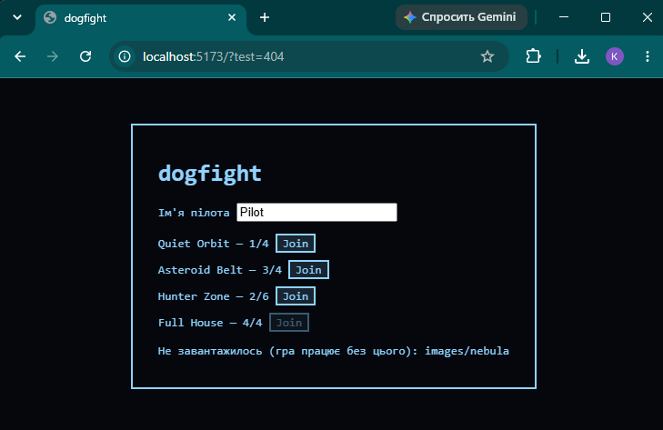
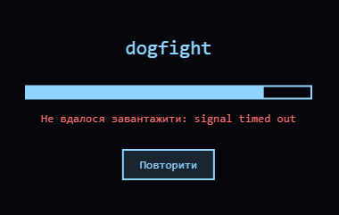
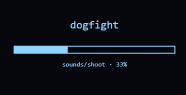
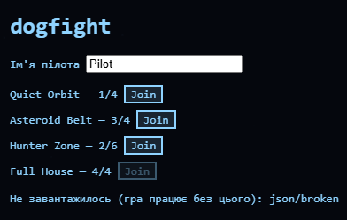

# dogfight

Корабель на canvas, керований фіксованим таймстепом, рендер інтерпольований під частоту монітора.

## Запуск

```
npm install
npm run dev
```

Відкрити посилання з консолі (http://localhost:5173).

Керування: стрілки або WASD, вгору/W — тяга, пробіл або кнопка FIRE — постріл.

## Lab 1 — M1–M3

- [x] цикл на requestAnimationFrame з фіксованим кроком 1/60 і clamp'ом дельти
- [x] HUD зліва: steps/s, frames/s, час кадру
- [x] клавіатура - замикання, justPressed з'їдає сам себе
- [x] корабель - чиста функція integrate, без рендеру всередині
- [x] wrap по краях арени
- [x] рендер інтерпольований (lerp / lerpAngle), корабель не смикається
- [x] canvas під DPR, ресайз по вікну

## Lab 1 — M4, три поломки

### 1. Busy-wait у render

Додав `while (performance.now() < t + 100) {}` всередину render раз на 60 кадрів.

Що видно на екрані: Гра стає плавною (у звичайний момент `frames/s` тримається на рівні ~147, а час кадра біля `5.70 ms`), але рівно раз на секунду відбувається помітний мікрофриз (ривок) картини. У цей момент час кадру різко стрибає вище 100 мс, а `frames/s` суттєво просідає.

Чому це не обійти з JS того самого потоку: цикл рендеру і симуляції виконуються на одному call stack'у. Поки функція `render` не завершиться, event loop не може забрати наступну задачу з черги — ні requestAnimationFrame, ні paint браузера, ні обробку клавіш. Асинхронність (проміси, await) тут не рятує, бо `while` — синхронний код, він блокує стек, а не чекає в черзі.

### 2. setInterval(16) замість requestAnimationFrame

Замінив rAF на `setInterval(frame, 16)`.

frames/s за 10 с: 58–62 FPS (показники тримаються відносно рівно через штучну фіксацію кроку таймера в коді, але позбавлені плавної прив'язки до частоти оновлення монітора)
джиттер (розкид часу кадру): низький усередині активної вкладки через стабільний виклик `setInterval`, проте час кадру не гарантує точної синхронізації з VSync
у фоновій вкладці 5 с і назад: таймер не призупинився повністю (на відміну від rAF), а продовжив працювати у фоні; при поверненні у вкладку анімація може виконати короткий ривок через накопичення невідпрацьованих або зсунутих кадрів.

Очікувано: setInterval не синхронізований з паллетом монітора (16 ≠ 16.667 мс на 60 Hz), тому з часом розсинхронізується з реальним рефрешем; у фоновій вкладці браузер не зупиняє його так агресивно, як rAF, тому анімація може "стрибати" при поверненні.

### 3. Змінний крок замість accumulator

Прибрав accumulator, викликав `simulate(dt)` один раз за кадр з реальним dt.

Throttle CPU 6× у DevTools, позиція корабля після 5 с утримання тяги:
- без throttle: x ~ 920, y ~ 680 (на високій герцовці монітора 180 Гц кадри малюються дуже часто, дельта `dt` мала, тому фізика за 5 секунд робить багато дрібних і плавних кроків)
- з throttle 6×: x ~ 310, y ~ 220 (через 6-кратне сповільнення процесора час кадру різко зріс, кількість викликів симуляції за 5 секунд значно зменшилася, через що корабель пролетів набагато меншу відстань)

Після повернення fixed-step — позиції збігаються: так (завдяки фіксованому кроку 1/60 с і паттерну з аккумулятором симуляція виконує строго однакову кількість кроків незалежно від частоти кадрів монітора чи навантаження на процесор).

Висновок: при змінному кроці результат симуляції залежить від того, як часто малюються кадри, тобто від продуктивності машини — неприйнятно для мультиплеєра, де сервер і різні клієнти мають дійти до однакового стану.

## Lab 2 — M1–M4

- [x] Vector2 з чистими методами (add/sub/scale/length/normalize/rotate/dot, static fromAngle)
- [x] Entity — приватний статичний лічильник id, update(dt)
- [x] Ship extends Entity — один рівень успадкування
- [x] World на Map, ітерований, ofKind-генератор, deferred despawn
- [x] Bullet (ttl), Asteroid (дрейф + відбиття)
- [x] findCollisions — окрема система, лише виявляє пари (a, b)
- [x] #hp приватне поле, damage/heal, вибух, респаун через 2с, рахунок у HUD
- [x] homing (композиція через обгортання update) і pickup (композиція через Entity + apply)

### this-баг

Перший варіант підключення кнопки стрільби:

```js
fireButton.addEventListener('click', ship.fire);
```

У такому вигляді `fire` передається як гола функція. Браузер викликає її сам, і на момент виклику `this` всередині — елемент кнопки (`fireButton`), а не `ship`. Код типу `this.pos.add(...)` падає, бо в кнопки немає `pos`.

Полагодив тим, що `fire` у `Ship` — поле-стрілка, а не метод на прототипі:

```js
fire = (world) => {
  ...
};
```

Стрілка не має власного `this`, вона бере його лексично з конструктора — звідти, де `this` уже дорівнює інстансу `Ship`. Тому навіть якщо передати `ship.fire` окремо від `ship`, `this` всередині лишається правильним.

Альтернативи, які теж працюють, але без поля-стрілки:
- `fireButton.addEventListener('click', ship.fire.bind(ship))` — `bind` явно прив'язує `this`, але повертає нову функцію щоразу, якщо викликати так у циклі/рендері.
- `fireButton.addEventListener('click', () => ship.fire(world))` — обгортка; саме так і зроблено для самої кнопки в `main.js`, бо туди ще й треба передати `world`.

Поле-стрілка коштує трохи пам'яті (окрема функція на кожен інстанс `Ship`, а не одна на прототипі), але для одного-двох методів на сутність це не проблема, а код читається прямолінійно.

### Композиція замість спадкування (M4)

Два місця, де напрошувався б глибший `extends`, і чому я туди не пішов:

**Homing.** Якби робити через класи, знадобилось би або `HomingBullet extends Bullet`, або дублювати логіку наведення в `HomingBullet` і `HomingAsteroid` окремо — спільної точки в дереві для них нема, бо `Bullet` і `Asteroid` вже обидва на першому рівні під `Entity`. У `homing.js` замість цього я обгортаю готовий `update` будь-якої сутності: беру поточний `update`, зберігаю його як `baseUpdate`, і підміняю на новий, який спершу підправляє напрямок у бік цілі, а тоді викликає оригінальний `update`. Працює однаково і для кулі, і для астероїда, без жодного нового класу.

**Pickup.** Pickup не літає, не стріляє і не має `#hp` — йому не потрібна жодна з особливостей `Ship`. Робити `Pickup extends Entity` заради одного поля було б чесно, але простіше: беру звичайний `Entity` (в нього і так `vel = 0` за замовчуванням, тобто він вже "стоїть на місці" і бере участь у колізіях через `radius`) і навішую `effect` і `apply(ship)` прямо на інстанс. Це рівно те, про що Section 3 лаби каже "behavior as data" — ефект — це просто рядок ('shield' / 'rapidfire'), яким `handlePair` у `main.js` і керується.

Якби я пішов шляхом `class Pickup extends Entity` і `class HomingBullet extends Bullet`, дерево почало б розповзатись при кожній новій комбінації (homing-pickup? бронебійна куля, яка ще й наводиться?) — кожна нова комбінація потребувала б нового класу. Композицією ці речі просто комбінуються в рантаймі.

## Lab 3 — Асинхронний JS: завантаження, звук, лобі

### M1 — завантаження

- `fetchOk` перевіряє `res.ok` (fetch не reject-ить 404) і зливає таймаут `AbortSignal.timeout` із зовнішнім signal через `AbortSignal.any`.
- `withRetry`: експоненційний backoff з jitter. Повторює тільки мережеву помилку, таймаут і 5xx. 4xx, abort і битий JSON повтором не лікуються.
- `loadAll`: кожен запис вантажиться паралельно, до кожного промісу додано `.then`, що рахує прогрес, потім `Promise.all`. Якщо падає критичний файл, решту скасовую сам (`Promise.all` сусідів не зупиняє). Файл з `optional: true` при помилці потрапляє в `failed`, гра стартує без нього.
- Гра стартує лише після `await loadAll(...)`. Далі лобі, потім гра.

Послідовно vs паралельно (`?test=slow` додає штучну затримку, час друкується в консоль: `[assets] loaded in ... ms`):

- `Promise.all` (паралельно): 3068  мс
- послідовні `await` у гілці: 10614 мс

Для порівняння в гілці замінити в `loadAll` рядок `Promise.all(jobs)` на цикл, де кожен запис вантажиться тільки після попереднього.

### M2 — спрайти і звук

Сим (`src/sim`) не імпортує ні `audio.js`, ні `hud.js`. `World extends EventTarget` і кидає події `fired`, `hit`, `exploded`, `scored`; `audio.attach(world)` і `createHud(world)` на них підписуються. AudioContext стартує після першого кліку чи натискання клавіші, буфери декодуються ще на екрані завантаження. У консолі до першого жесту може бути попередження Chrome про AudioContext, це очікувано.

Дрібне виправлення з Lab 2: pickup `rapidfire` раніше нічого не робив, тепер `Ship.fire` скорочує перезарядку вдвічі.

### M3 — лобі по HTTP

`Lobby extends EventTarget`: `start()`, `stop()`, `refresh()`, `join(roomId, name)`; події `roomsChanged`, `refreshFailed`, `joined`. Оновлення списку кожні 5 с, кожен запит з таймаутом 4 с. Новий `refresh()` скасовує попередній запит, а `stop()` (при виході з лобі) гасить таймер і скасовує запит, що ще летить. DOM окремо в `lobbyView.js`. Вибрана кімната передає свій `arena` у гру і перекриває `arena.json`.

### M4 — головоломки порядку

Виводи 1, 2, 4, 5 перевірені в Node 22, головоломка 3 призначена для браузера.

**1. await і таймер**

```js
console.log('A');
(async () => {
  console.log('B');
  await Promise.resolve();
  console.log('C');
})();
setTimeout(() => console.log('D'), 0);
console.log('E');
```

Вивід: `A B E C D`. До `await` async-функція виконується синхронно (B). Продовження C це мікрозадача, вона йде перед таймером D.

**2. setTimeout всередині then**

```js
setTimeout(() => console.log('timeout 1'), 0);
Promise.resolve()
  .then(() => {
    console.log('then 1');
    setTimeout(() => console.log('timeout 2'), 0);
  })
  .then(() => console.log('then 2'));
```

Вивід: `then 1`, `then 2`, `timeout 1`, `timeout 2`. Обидва `then` це мікрозадачі і біжать до першої задачі. Таймер, поставлений зсередини then, стає в чергу задач після timeout 1.

**3. requestAnimationFrame і мікрозадачі**

```js
requestAnimationFrame(() => {
  console.log('raf1');
  Promise.resolve().then(() => console.log('micro1'));
});
requestAnimationFrame(() => console.log('raf2'));
```

Вивід: `raf1`, `micro1`, `raf2`. Після кожного rAF-колбека браузер спустошує мікрочергу, тому micro1 встигає до raf2.

**4. async return проти звичайного return**

```js
async function f() { return 1; }
async function g() { return Promise.resolve(1); }
g().then(() => console.log('g'));
f().then(() => console.log('f'));
Promise.resolve().then(() => console.log('p1')).then(() => console.log('p2')).then(() => console.log('p3'));
```

Вивід: `f p1 p2 g p3`. `f` повертає звичайне значення і його then стає в чергу одразу. `g` повертає проміс, і async-функція витрачає додаткові мікрозадачі на його розгортання, тому `g` з'являється на два кроки пізніше.

**5. catch, finally і queueMicrotask**

```js
Promise.reject(new Error('x'))
  .catch(() => console.log('caught'))
  .finally(() => console.log('finally'));
queueMicrotask(() => console.log('qm'));
console.log('sync');
```

Вивід: `sync caught qm finally`. `catch` вже стояв у черзі, коли додали `qm`. `finally` стає в чергу тільки після того, як відпрацює `catch`, тобто після `qm`.

### M4 — галерея помилок

Кожен випадок відтворюється адресою з параметром, вставити скріншот або лог:

| Сценарій | Як відтворити | Що має бути | Скріншот |
|---|---|---|---|
| 404 спрайт | `/?test=404` | гра стартує, у лобі примітка про `images/nebula`, у консолі warning |  |
| таймаут мережі | `/?test=timeout` | три спроби з backoff, на екрані червоний текст і кнопка "Повторити" |  |
| abort посеред завантаження | `/?test=slow`, натиснути Esc | "Завантаження скасовано" і кнопка "Повторити", запити скасовані |  |
| биттий JSON | `/?test=badjson` | `SyntaxError` без повторів, гра стартує, у лобі примітка про `json/broken` |  |